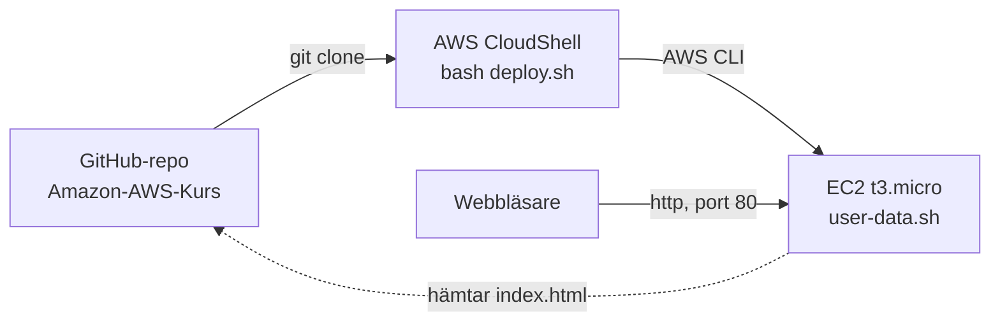

# Amazon-AWS-Kurs

**Adrian Ahlborg** · Amazon Web Services · Moln- och virtualiseringsspecialist, Campus Mölndal

Kursprojekt där företaget **Novatrix AB** flyttar sin webbplats till AWS. En mapp per vecka; varje vecka bygger vidare på samma miljö.

| Vecka | Tema | Mapp |
|---|---|---|
| v42 | Compute – EC2-webbserver som skapas helt från kod | [v42](./v42) |

---

## v42 – EC2-webbserver från kod

En EC2-instans (Amazon Linux 2023, `t3.micro`) i region Stockholm kör Apache och visar Novatrix webbsida på instansens publika IP. Hela miljön skapas med ett kommando i AWS CloudShell och tas bort med ett annat. Inget klickas fram i konsolen.



### Vad som skapas

| Resurs | Namn | Inställning |
|---|---|---|
| Key pair | `novatrix-key` | ED25519 |
| Security group | `novatrix-web-sg` | Port 80 från alla, port 22 bara från angiven IP |
| EC2-instans | `novatrix-web-v42` | `t3.micro`, senaste Amazon Linux 2023, publik IPv4 |
| Webbserver | Apache (`httpd`) | Installeras och startas av user data |
| Webbsida | `v42/webb/index.html` | Hämtas från det här repot vid uppstart |

### Förutsättningar

- Ett AWS-konto (Free plan räcker).
- Konsolen inställd på **Europe (Stockholm) `eu-north-1`**.
- Repot är publikt, eftersom instansen hämtar webbsidan härifrån.

Inga verktyg behövs lokalt. AWS CloudShell har AWS CLI och git förinstallerat och är redan inloggat.

### Skapa miljön

1. Ta reda på din publika IP (behövs bara om du vill kunna SSH:a). I PowerShell:

   ```powershell
   curl.exe ifconfig.me
   ```

2. Öppna **CloudShell** i AWS-konsolen och kör:

   ```bash
   git clone https://github.com/adrianahlborg404-png/Amazon-AWS-Kurs.git
   cd Amazon-AWS-Kurs/v42/scripts
   bash deploy.sh <DIN-PUBLIKA-IP>
   ```

3. Skriptet skriver ut instansens publika IP. Vänta 1–2 minuter medan user data installerar Apache.

### Verifiera

```bash
curl -I http://<PUBLIK-IP>        # förväntat: HTTP/1.1 200 OK, Server: Apache
```

Öppna `http://<PUBLIK-IP>` i webbläsaren. Använd **http**, port 443 är inte öppen.

Valfritt, logga in via SSH. Nyckeln `novatrix-key.pem` ligger i `v42/scripts/` i CloudShell:

```bash
ssh -i novatrix-key.pem ec2-user@<PUBLIK-IP>
systemctl status httpd --no-pager                # active (running)
sudo tail -n 20 /var/log/cloud-init-output.log   # loggen från user data
```

SSH från CloudShell kräver att port 22 tillfälligt öppnas för CloudShells IP:

```bash
CS_IP=$(curl -s https://checkip.amazonaws.com)
SG_ID=$(aws ec2 describe-security-groups --group-names novatrix-web-sg \
  --query 'SecurityGroups[0].GroupId' --output text)
aws ec2 authorize-security-group-ingress --group-id $SG_ID --protocol tcp --port 22 --cidr ${CS_IP}/32
# ... efter SSH:
aws ec2 revoke-security-group-ingress --group-id $SG_ID --protocol tcp --port 22 --cidr ${CS_IP}/32
```

### Ta bort miljön

```bash
bash teardown.sh
```

Terminerar instansen och tar bort security group och key pair. Kör alltid `teardown.sh` innan `deploy.sh` körs igen, annars skapas en andra instans.

### Så fungerar skripten

| Fil | Körs var | Gör |
|---|---|---|
| [`v42/scripts/deploy.sh`](v42/scripts/deploy.sh) | CloudShell | Hämtar AMI, skapar key pair och security group, startar instansen med user data |
| [`v42/scripts/user-data.sh`](v42/scripts/user-data.sh) | Instansen, vid första start | Installerar Apache, hämtar `index.html`, startar tjänsten |
| [`v42/scripts/teardown.sh`](v42/scripts/teardown.sh) | CloudShell | Tar bort allt som `deploy.sh` skapade |
| [`v42/webb/index.html`](v42/webb/index.html) | Serveras av Apache | Novatrix webbsida |

Designval:

- **Ingen hårdkodad AMI.** Senaste Amazon Linux 2023 hämtas från SSM-parametern `/aws/service/ami-amazon-linux-latest/al2023-ami-kernel-default-x86_64`.
- **Tål att köras igen.** Key pair och security group återanvänds om de redan finns.
- **Taggar.** `Name=novatrix-web-v42` gör att `teardown.sh` hittar rätt instans.
- **SSH är begränsat.** Port 22 öppnas bara för den IP som anges, aldrig för `0.0.0.0/0`.
- **Repot är källan.** För att ändra webbsidan: committa `index.html`, kör `teardown.sh` och sedan `deploy.sh`.

### Kostnad och säkerhet

- `t3.micro` är free tier-berättigad för nya konton.
- En budget i AWS Budgets (5 USD per månad) larmar via e-post på faktisk och prognostiserad kostnad.
- Miljön rivs med `teardown.sh` efter varje arbetspass.
- `.gitignore` stoppar privata nycklar (`*.pem`, `*.ppk`) från att hamna i repot.

### Filstruktur

```
Amazon-AWS-Kurs/
├── README.md
├── .gitignore
└── v42/
    ├── webb/index.html
    └── scripts/
        ├── deploy.sh
        ├── user-data.sh
        └── teardown.sh
```
